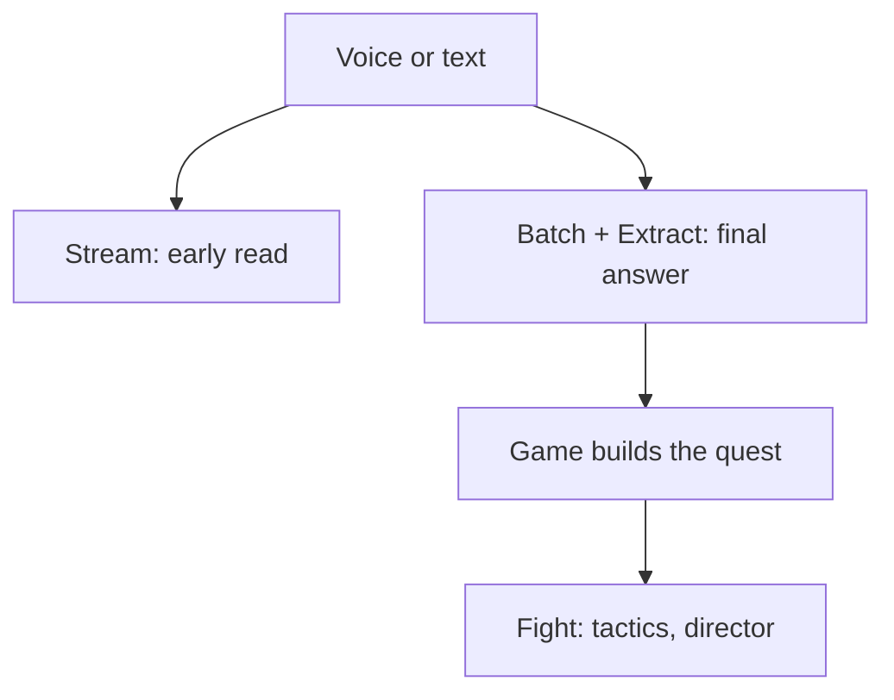
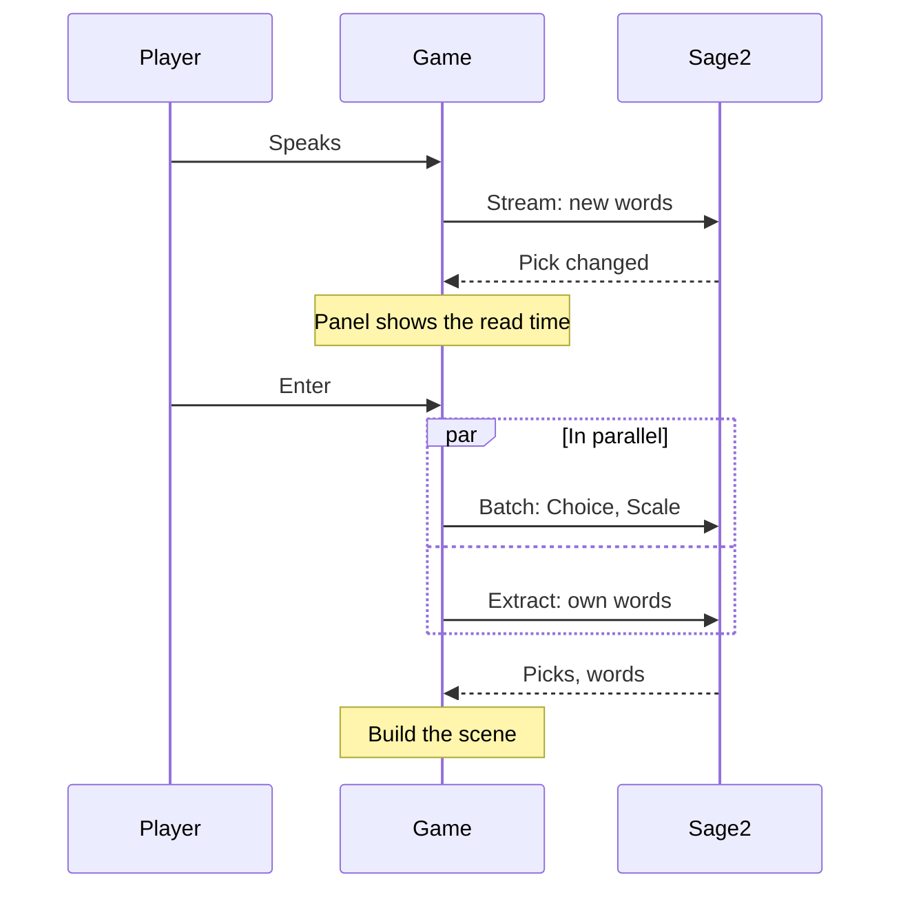
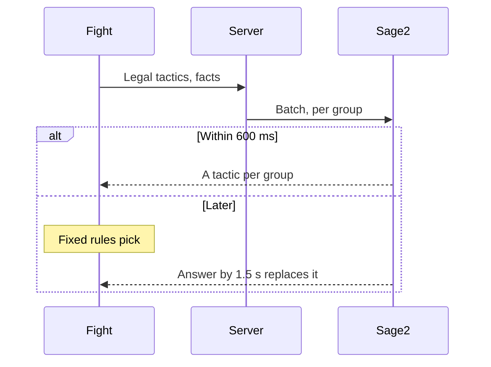

# Architecture

Sage Quest has three parts: a three.js game in the browser, a small Node server, and Sage2. The browser sends the player's text and the facts of the fight to the server. The server builds every Sage2 request and keeps the API key. Sage2 returns picks, numbers and extracted words. The browser builds the scene from them.

## Terms

| Term | Meaning |
|---|---|
| Kit | The options that the game gives Sage2. Most Choices pick from the kit. The weapon-name Choice picks from the player's words. |
| Campfire | The scene where the player answers the seven questions. |
| Land (`biome`) | One of 8 land types, such as the Drowned Fen or the Ashlands. Each world draws them in its own style. |
| Hero (`archetype`) | The hero class: knight, barbarian, mage or rogue, or the world's own names for them. |
| Loved ones (`companions`) | The people and pets that the player names. |
| Motive | Why the hero fights. It selects one of 5 quest shapes. |
| Enemy (`nemesis`) | The boss. Sage2 picks it from the world's list. |
| Minions | The enemy's servants. They fight the hero in groups. Sage2 picks their names, such as Clerks or Debts, from 11 kit options. |
| Seed | A number from a hash of the player's name. It makes random details repeatable. |
| Director | A Sage2 stream on the fight's event log. After the first wave, it chooses rest (a 30% heal) or a reinforcement pack. Only the revenge quest uses the pack. |

## When Sage2 is not sure

Sage2 returns a probability for each option, or no pick. The leader is the option with the highest probability.

- Land, hero, motive and enemy: when Sage2 returns a pick, the game takes it. With no pick, the game takes the leader at 55% or more with a lead of 15 percentage points. Otherwise the player sees two buttons, the leader and the second option, for 4 seconds. With no click, the game takes the leader. If Sage2 returns no leader, the seed picks. For the motive, a word match runs before the seed.
- For the world: with no pick, the game takes the leader at 45% or more. Otherwise the game keeps the current world.
- For a tactic: the game takes the leader.

## Every Sage2 call

| When | Request | The game uses it for | When Sage2 is late or fails |
|---|---|---|---|
| Name | Extract `name` | The name on the stone, the seed | Up to two words of the answer become the name |
| Home | Batch: Choice `biome`, Choice `world`. Extract `place`, in parallel | World, land, place name | The seed picks the land. The world stays as it is, with no place name |
| Birth date | Extract `birth_date`, `birthday` | Star sign, age | The server reads the month and day from the text. If the step request fails, or the text has no month and day, the sign stays hidden |
| Daily life | Choice `archetype`, Scale `build`. Extract `trade` | Hero class and body. The build also scales the hero's damage | The seed picks the hero class. The body keeps the default build |
| Loved ones | Choice `motive`. Extract `companions`, `desire` | Quest shape, the people in the quest, the hero's named power (such as Shield or Vengeance). The wish is quoted at camp | The game matches words in the answer to a motive. With no match, the seed picks |
| Enemy | Choice `nemesis` from the world's list, Scale `tone`, Choice `minions`. Extract `enemy` | Boss, look of the world, minion names | The seed picks the boss. The look and the minion names keep their defaults |
| While the player speaks | Stream: the step's Choice | A panel row with the words so far and the read time. No pick is shown. The scene waits for Enter | The final batch decides |
| Weapon | Extract the weapon words | A word of the player's own that is not a standard weapon or material (such as "mozzarella"). It names the weapon | The game matches weapon, material and element words in the answer. With no match, the world's first weapon, in iron, with an element from the seed |
| Weapon, in parallel | Batch: Choice `weapon`, `material`, `element`, and Choice `answer` (the kind of answer) | The weapon | Same as above |
| Weapon name, in parallel | Choice from the loved ones and the home place | Who the weapon is named after | A stock name from the element, such as Winterbite |
| Fight, per group of fighters (the boss too, except the Hollow Dragon) | Batch: one Choice `tactic` per group, from the legal tactics. A group with one legal tactic gets it without a call | What each group does next | After 600 ms, the fixed rules decide. A Sage2 answer that arrives within 1.5 s replaces them if the tactic is still legal |
| After the first wave | Stream on the event log: Choice `beat`, Scale `pressure` (logged, not used) | Rest (a 30% heal), or a reinforcement pack for chapter II of the revenge quest | After 6 s with no answer, a rule on the hero's health decides |
| Camp, before the boss | Choice `resolve`. Extract `vow`, in parallel | A bonus in the boss fight, the hero's vow | The resolve that matches the motive |

## One step of character creation

## One tactics tick

## Code map

| Path | What is there |
|---|---|
| [`game/questions.mjs`](game/questions.mjs) | Every Sage2 question: the six creation steps, the weapon, tactics, director, vow |
| [`game/kit.mjs`](game/kit.mjs) | The options: heroes, lands, motives, minions, tactics, director beats, resolves |
| [`game/worlds.mjs`](game/worlds.mjs), [`game/worlds/`](game/worlds) | The five worlds and the options each one gives later questions |
| [`game/story.mjs`](game/story.mjs) | Quest shapes, and story lines filled with the player's words |
| [`server/sage.mjs`](server/sage.mjs) | Sage2 client: batch, extract, stream, a second request when a call is slow, retries |
| [`server/server.mjs`](server/server.mjs) | Local server: creation steps, weapon, tactics, vow, stream relays |
| [`server/http-api.mjs`](server/http-api.mjs), [`api/`](api) | The same API as Vercel functions, with a session token and rate limits |
| [`web/src/main.js`](web/src/main.js) | Character creation: speech, steps, the two-button question, the weapon |
| [`web/src/net.js`](web/src/net.js), [`web/src/net-http.js`](web/src/net-http.js) | Stream client, and its HTTP form for the live site |
| [`web/src/fight.js`](web/src/fight.js) | Combat, the tactics tick, legal tactics, fixed rules, director |

## Security

- The API key stays on the server. The browser sends text and facts only.
- The server builds every question. It caps text at 1,200 characters a field and 16 KB a request, and limits calls per IP.
- Sage2 can pick only from the options in the request. The game checks each tactic again before it uses it.
