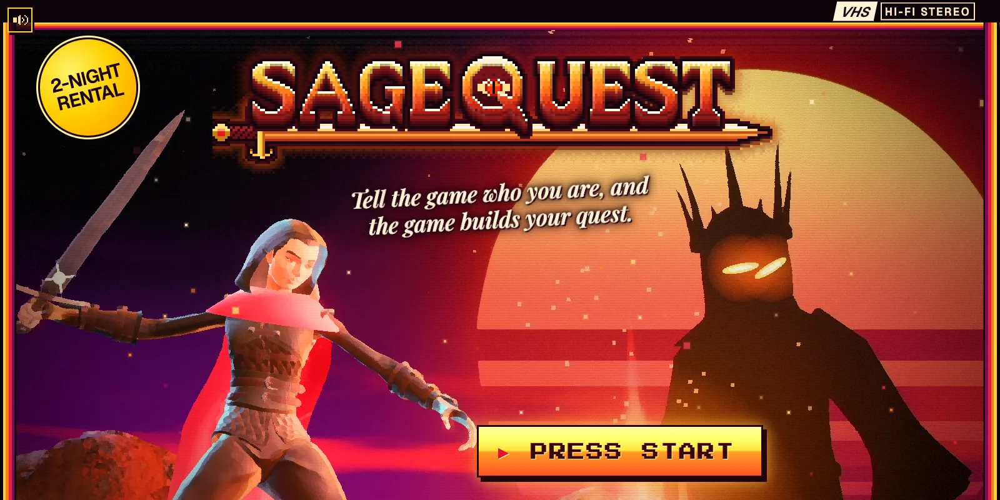
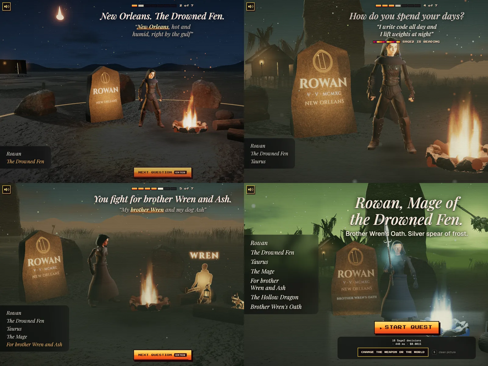
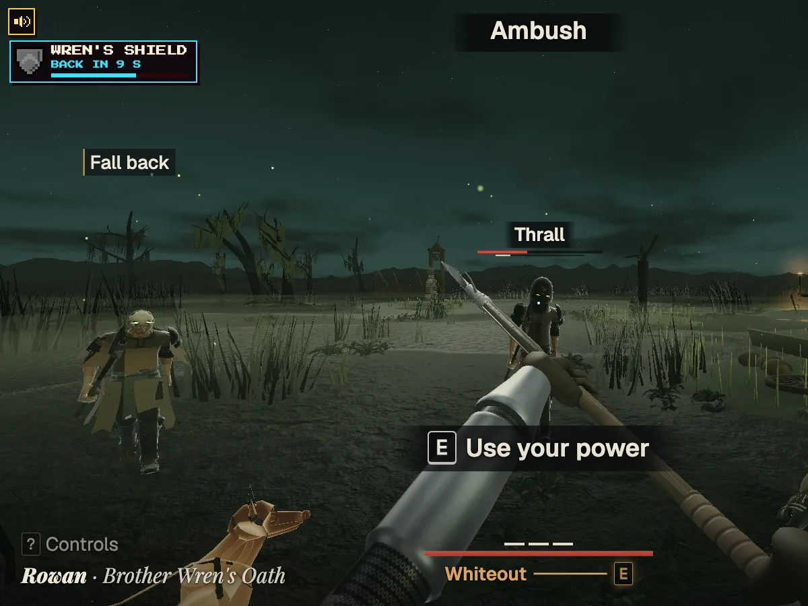

<div align="center">



# Sage Quest

**A browser quest built from the player's own words. [Sage2](https://levanto.ai), Levanto's decision model, makes the decisions.**

In a fight, the game asks which tactic each group of fighters uses next. Sage2 answered in a median 264 ms, at $0.0000162 a decision. Fable 5.2, the LLM that wrote the game code, took 2.5 s and $0.0099. The fixed rules that Fable 5.2 wrote never used 3 of the 6 tactics. Sage2 used all 6.

[Play](https://sage-quest-one.vercel.app) · [Measured](#sage2-against-an-llm-and-fixed-rules) · [How it works](#how-it-works) · [Try the blocks](#try-sage2) · [Run it](#run-it)

</div>

## What it does

The player answers seven questions by voice or text: name, home, birth date, daily life, loved ones, enemy and weapon. Sage2 makes the decisions for the world, the hero, the quest and the fight.

Sage2 works with building blocks. A Choice picks one option from a list. A Scale gives a number on a scale. An Extract takes words from the answer.



| Step | Player said | Sage2 calls | Result |
|---|---|---|---|
| Home | "New Orleans, hot and humid, right by the gulf" | Choice world, Choice land, Extract place | The Drowned Fen |
| Daily life | "I write code all day and I lift weights at night" | Choice hero, Scale build, Extract trade | Mage |
| Loved ones | "My brother Wren and my dog Ash" | Choice motive (why the hero fights), Extract loved ones | A quest to protect Wren and Ash |
| Weapon | "Forge me a silver spear that carries frost" | Extract weapon words, 4 Choices (weapon, material, element, kind of answer), Choice of a loved one | A silver spear of frost, named after Wren |

One scripted play, from the first answer to the end card, cost **$0.0021** in Sage2 calls. The panel in the last frame comes from the same play. It counts the seven answers only ($0.0015), not the fight.

## Sage2 against an LLM and fixed rules

Without Sage2, a game like this can ask an LLM or use fixed rules. In a fight, the minions fight in groups. For each group, the game picks one of 6 tactics: `charge`, `flank`, `call` (for help), `feint`, `guard` or `retreat`. A fight state lists the facts for one group: its size, health and distance, and the hero's action. It also lists the legal tactics: the ones that the fight rules allow for that group. We tested Sage2 and the fixed rules on 256 fight states. In 16 of them, 1 tactic is legal, so the game needs no call. Sage2 got the other 240. Each LLM got a sample of 43 of those states.

| | Sage2 | LLM: Haiku 5.5 | LLM: Fable 5.2 |
|---|---|---|---|
| Median time per decision | **264 ms** | 1.6 s | 2.5 s |
| Mean cost per decision | **$0.0000162** | $0.00017 | $0.0099 |
| Probability for each option | **Returned** | Not returned | Not returned |

The Sage2 time includes the network round trip from Europe. The LLM time is the model call time that the Claude Code CLI reports, without start-up. The LLM cost is the list price that the CLI reports. It includes the CLI's own system prompt and the model's thinking tokens. Sage2 ran with reasoning off.

The game also has fixed rules, written by Fable 5.2, for when Sage2 is late. On 256 fight states, the fixed rules chose `charge` 176 times. They never chose `feint`, `guard` or `retreat`, so a hurt group never retreats. Sage2 used all 6 tactics. [Method and raw files](docs/measurements.md).

### One real decision

This fight state is in the game's request format (built by `bench/one-decision.mjs`), and Sage2 answered it live. The group started with 2 Hollow Guards, and 1 is left. The remaining guard stands 2 paces from the hero, and the hero is blocking. The request calls the hero "the intruder". The game lists three legal tactics for this group:

| Tactic | Its description in the request (shortened) | Sage2 probability |
|---|---|---|
| **`feint`** ✓ | Step in, step back, then strike to break the guard. Fits when the intruder is blocking and close. | **98.1%** |
| `charge` | Run at the intruder. Fits when the intruder is far away, moving or hurt, and when no other tactic fits. | 1.6% |
| `guard` | Hold the line and strike back. Fits when the intruder swings and is close. | 0.3% |

The fixed rules choose `charge` here. They pick only `flank`, `call` or `charge`, and a group of one cannot flank. Sage2 chose `feint` in 137 ms of server time. [Full request and response](examples/one-decision.json).

### Sage2 reads the answer before the player stops speaking

Sage2 can also read the answer as a stream while the player speaks. On 54 of 57 test answers, Sage2 had its final pick before the last word. The median lead was 2.2 s. The test replayed each answer at one word every 400 ms. The stream runs when you run the game with `npm start`. The live site sends one batch call on each pause in speech instead. In both, the scene waits for Enter: the Sage2 panel shows the words and the read time, not the pick. [How the stream works](docs/streaming.md).

## How it works

**Sage2 decides. The game code builds.** Most decisions are multiple-choice questions. The options come from the game's kit: 5 worlds, 8 lands, 4 heroes, 5 quest shapes and 6 tactics. Sage2 returns a probability for each option, or no pick when it is not sure. The game then builds the scene from that option. When Sage2 returns no pick, the game follows [these rules](ARCHITECTURE.md#when-sage2-is-not-sure).



The label "Fall back" is the tactic `retreat`, which Sage2 chose for the group on the left. The fixed rules never choose it.

**Sage2 extracts** the player's own words: the name, home, loved ones, enemy and the hero's vow. The vow is the reason that the player gives at camp to continue. The story repeats these words as the player said them.

**The game code** records speech in the browser and sends the text. The server builds every request. The browser draws the scene and runs the fight. When Sage2 is late, the game code uses the seed (a number from the player's name) or the fixed rules. [Every call in detail](ARCHITECTURE.md).

## Try Sage2

Sage Quest uses five Sage2 building blocks. You can use the same blocks in your app.

| Block | What it does | In Sage Quest |
|---|---|---|
| **Choice** | Picks one option from your list and gives a probability for each | World, hero, tactic |
| **Scale** | Gives a number on a scale that you define | Body build, tone |
| **Extract** | Takes named fields from free text | Name, loved ones, vow |
| **Batch** | Sends many questions in one call | Up to 6 fight groups at once |
| **Stream** | Updates the decision while the text arrives | The answer while the player speaks |

The blocks combine. In a chain, the output of one call becomes the input of the next. [Eight patterns from this game](docs/combinations.md).

See more patterns at [levanto.ai/examples](https://levanto.ai/examples). The [free plan](https://platform.levanto.ai/login?utm_source=github&utm_medium=readme&utm_campaign=sage_quest) includes $1 of usage a month, which is about 480 plays like the one we measured.

To start, give this prompt to your coding agent:

```text
Read https://levanto.ai/examples
and https://github.com/christopherkocurek/sage-quest.
Which Sage2 building blocks fit my app,
and how do I combine them?
```

## Run it

You need Node.js (tested with Node 25) and a Sage2 API key.

```sh
git clone https://github.com/christopherkocurek/sage-quest.git
cd sage-quest
npm install
cp .env.example .env        # then add your SAGE_API_KEY (free plan above)
npm start                   # http://localhost:8790
```

Without a key, the game still runs. The seed and word matches decide character creation. The fixed rules decide the fight.

## Limits

- Speech-to-text is the browser's own (Web Speech API). Sage2 reads the transcript, not the audio.
- The game works best on a desktop with keyboard and mouse. A phone gets touch controls.

## License

[Apache 2.0](LICENSE). Asset sources and licenses: [CREDITS](web/assets/real/CREDITS.md) and [THIRD_PARTY](THIRD_PARTY.md).
