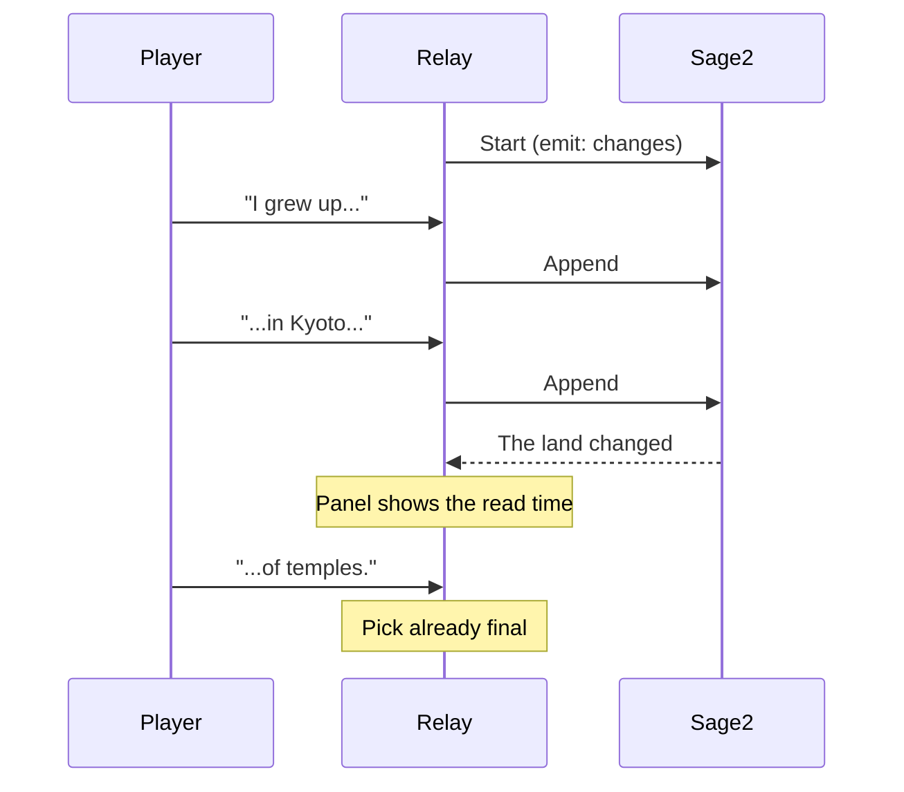

# Streaming

A batch call starts when the input is complete. A stream starts with the first word. Sage Quest uses the Sage2 stream in two places: while the player speaks, and in the fight.

With `emit: changes`, Sage2 sends a message only when the pick changes. With `emit: all`, it sends a message for each new input.

## While the player speaks

The browser's speech-to-text gives the transcript as it grows. The relay appends the new words to one Sage2 stream session, with `emit: changes`. The relay is the server code that passes text to Sage2. The game does not use these reads yet. Its panel shows the words so far and the read time, not the pick. The scene changes when the player presses Enter, from one batch call on the full answer.

On 54 of 57 test answers, the pick was final before the last word. [Full results](measurements.md#streaming).

The relay keeps one session per step. Sometimes the speech engine corrects a word, so the new text does not extend the old text. Then the relay opens a new session after 250 ms. The code is `onboardRelay` in [`server/server.mjs`](../server/server.mjs).

## In the fight

The fight writes one plain-text line to an event log for each wave, tactic, kill, block and hit. The relay appends each line to a second stream session, with `emit: all`. At the end of the first wave, the game asks for a decision (`evaluate`). Sage2 reads the whole log so far and chooses rest (a 30% heal) or a reinforcement pack. Only the revenge quest uses the pack.

The answer took a median of 322 ms through the relay, on test logs of one wave. The game waits up to 6 s, then uses a rule on the hero's health. The code is `directorRelay` in [`server/server.mjs`](../server/server.mjs) and `endWave` in [`web/src/fight.js`](../web/src/fight.js).

## On the live site

The live site uses Vercel, which cannot hold a WebSocket server. There, the browser sends one batch call on each pause in speech. A pause is 550 ms with no new words, and each step allows at most 14 calls. After the first wave, the browser sends the event log. The server keeps its opening line and the newest lines that fit in 12,000 characters. The questions are the same. The code is [`web/src/net-http.js`](../web/src/net-http.js) and [`server/http-api.mjs`](../server/http-api.mjs).

The stream runs when you run the game yourself with `npm start`.
